# C00 · Laboratorio y repositorio

**Objetivos LPI:** clase preparatoria (toca 103.1 y 102.1)
**Fecha:** 2026-11-25 al 2026-11-26 · 

**Objetivo:** tener un laboratorio Linux aislado y reproducible donde practicar comandos, particiones, servicios y recuperación sin riesgo para mi equipo.

## Entorno
| Componente | Valor |
| --- | --- |
| Virtualizador | virt-manager 5.1.0 (libvirt + QEMU/KVM) |
| Sistema invitado | Debian 13 "trixie" (13.8), sin escritorio |
| Kernel | 6.12.118+deb13-amd64 (x86_64) |
| Recursos | 2 GB RAM, 2 vCPU, 20 GB disco virtio (`vda`) |
| Disco extra | 5 GB SATA (`sda`), sin particionar |
| Red | NAT de libvirt, IP 192.168.122.x |
| Snapshots | `00-instalacion-limpia`, `01-disco-extra` |

## Ideas clave
1. Una VM sin escritorio (2 GB, 20 GB) es suficiente y se parece más a un servidor real; los snapshots funcionan como botón de deshacer.
2. virt-manager es una interfaz gráfica para libvirt/QEMU; con KVM (hipervisor dentro del kernel) la VM corre casi a velocidad nativa.
3. `lsblk` mostró `vda1` (`/`, 18.9G), `vda2` (1K, partición extendida) y `vda5` (swap, lógica): esquema MBR.
4. El nombre del dispositivo depende del bus: `vda` (virtio) y `sda` (SATA). El disco nuevo quedó listo para particionar en el bloque D.
5. Con la red NAT de libvirt el host llega a la VM directo: `ip a` en la VM da la IP y `ssh manuel@IP` abre una terminal cómoda, sin reenvío de puertos.

## Comandos
| Comando | Para qué sirve |
| --- | --- |
| `cat /etc/os-release` | distribución, versión y codename |
| `uname -a` | kernel, arquitectura y host |
| `lsblk` | discos y particiones en árbol |
| `df -h` | espacio por sistema de archivos montado |
| `free -h` | RAM y swap |
| `whoami` / `pwd` | usuario actual / directorio actual |
| `su -` | shell de login como root (entorno de root) |
| `ip addr` | interfaces y direcciones IP |
| `ssh usuario@ip` | conexión remota |
| `sha256sum -c` | verificar integridad contra una lista de hashes |

## Archivos importantes
| Ruta | Qué contiene |
| --- | --- |
| `/etc/os-release` | identificación de la distribución |
| `/etc/skel` | plantilla de archivos para nuevos HOME |
| `~/.bashrc` | configuración del shell interactivo |

## Errores comunes
- Verificar la ISO con el `md5sum.txt` interno: sirve para sus archivos, no para el `.iso`. Usar `SHA256SUMS` publicado junto a la ISO.
- Olvidar el espacio o el guion: `ip addr`, `uname -a`.

## Cómo lo preguntan en el examen
- Qué comando o archivo identifica la distribución, el kernel o la memoria.
- Qué hace `touch` sobre un archivo existente (solo actualiza fechas).

## Extra
- `mkdir -p evidencias/C{00..17}` crea 18 carpetas (expansión de llaves con ceros a la izquierda).
- Git no versiona carpetas vacías: se usa un archivo `.gitkeep` por convención.

## Evidencias
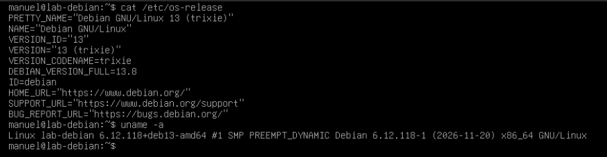

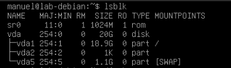
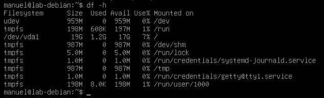
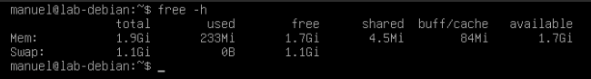
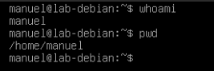
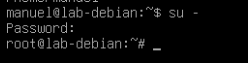
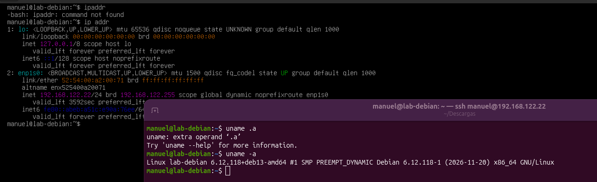
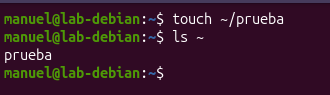
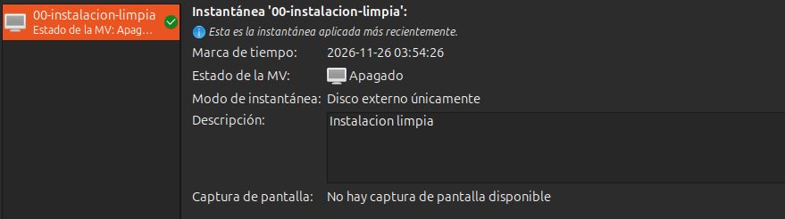
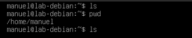
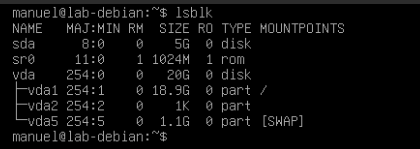
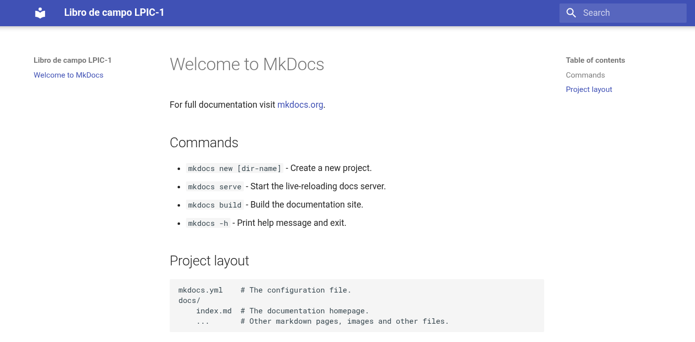

## Para repasar
- [Ejercicios](ejercicios.md)
- [Preguntas de autoevaluación](preguntas.md)
