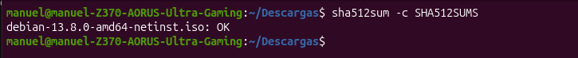
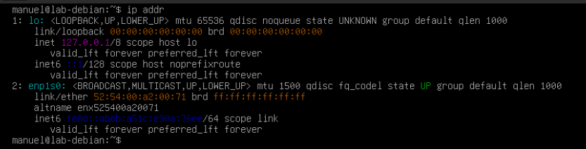
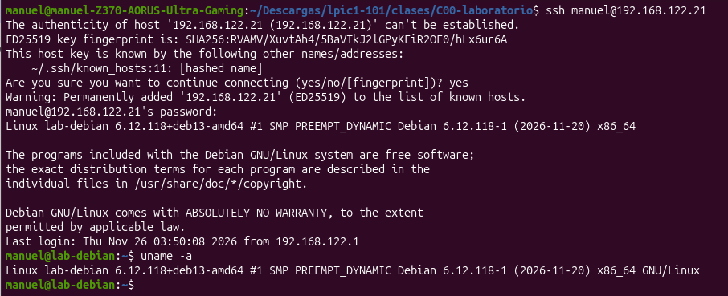
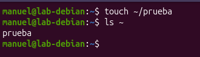
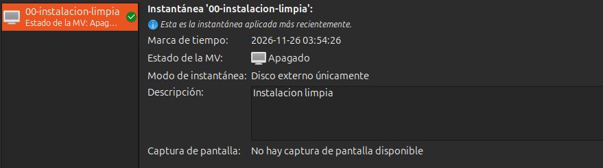
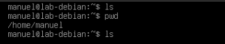

# C00 · Ejercicios

## Ejercicio 1 (guiado): verificar la ISO
**Consigna:** calcular el SHA-256 de la ISO y compararlo con `SHA256SUMS` del mirror de Debian.

**Comandos usados:**

~~~bash
cd ~/Descargas
sha512sums -c SHA512SUMS
~~~

**Resultado:**  coinciden: sí.

**Qué aprendí:** el `sha512.txt` interno de la ISO lista sus 933 archivos, por eso falló fuera de la ISO montada. El archivo correcto es `SHA512SUMS`, que está junto a la ISO en el mirror.

## Ejercicio 2 (guiado): conexión SSH
**Consigna:** conectarme a la VM y ejecutar `uname -a`; explicar el reenvío de puertos.

**Comandos usados:**

~~~bash
ip a                      # en la VM: IP de enp1s0
ssh manuel@192.168.122.22 # desde el host
uname -a
~~~

**Qué aprendí:** en la red NAT de libvirt el host alcanza la VM directamente por 192.168.122.x. El reenvío de puertos (por ejemplo `127.0.0.1:2222` del host al puerto 22 de la VM) hace falta en VirtualBox NAT, donde la VM no es alcanzable desde afuera.

## Ejercicio 3 (guiado): snapshot
**Consigna:** crear un archivo, restaurar el snapshot y demostrar que desapareció.

**Comandos usados:**

~~~bash
touch ~/prueba
ls ~
# apagar la VM y restaurar 00-instalacion-limpia en virt-manager
ls ~
~~~

**Qué aprendí:** restaurar el snapshot devuelve el disco al estado de la instalación limpia; todo lo posterior se pierde.

## Ejercicio 4 (rompé y arreglá)
**Qué rompí:** borré `~/.bashrc`.

**Síntoma:** al volver a entrar por SSH, COMPLETAR (cómo cambió el prompt, colores, alias).

**Cómo lo arreglé:**

~~~bash
rm ~/.bashrc
exit
# volver a entrar y observar
cp /etc/skel/.bashrc ~/
source ~/.bashrc
~~~

**Qué aprendí:** `/etc/skel` es la plantilla de archivos que se copia al HOME de cada usuario nuevo. COMPLETAR con lo que observé.

## Ejercicio 5 (integración)
**Consigna:** `git status` y `git log --oneline`, y reconstruir el laboratorio en 5 líneas.

~~~bash
git status
git log --oneline
~~~

**Para qué sirve:** `git status` confirma que no hay cambios sin guardar y que estoy sincronizado con GitHub. `git log --oneline` muestra el historial: cada clase deja al menos un commit como evidencia.

**Reconstruir el laboratorio:**
1. Descargar la ISO netinst de Debian y verificar con `SHA256SUMS`.
2. Crear la VM en virt-manager (2 GB RAM, 20 GB disco, red NAT) y adjuntar la ISO.
3. Instalar sin entorno gráfico, con servidor SSH y una sola partición; crear root y usuario normal.
4. Tomar el snapshot `00-instalacion-limpia`; averiguar la IP con `ip a` y conectar por SSH.
5. Agregar un disco SATA de 5 GB, tomar `01-disco-extra`, y clonar el repo con MkDocs
